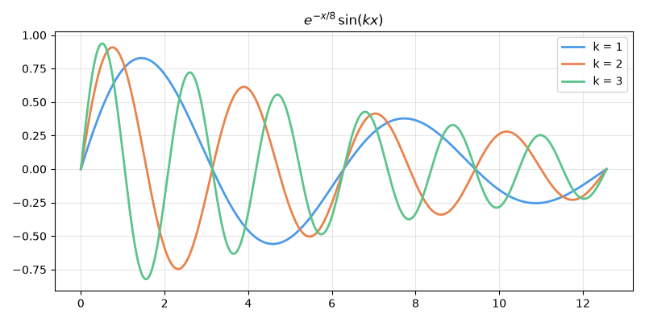

# mark-tui demo

Open this file and run `:MarkTuiOpen`. Move the cursor around and the
preview follows; scroll the preview with `j`/`k`, `<C-d>`/`<C-u>`, `gg`/`G`
and this buffer follows back.

## Text

Plain paragraphs wrap to the preview width. You get **bold**, *italic*,
***both***, ~~strikethrough~~, `inline code`, and
[links](https://github.com/Textualize/rich).

> Block quotes are indented and dimmed.
>
> > And they nest.

---

## Lists

- Unordered item
- Another item
  - Nested item
  - Another nested item
- Back to the top level

1. First
2. Second
3. Third

- [ ] A task to do
- [x] A finished task

## Images

A local PNG, drawn inline through kitty Unicode placeholders:



A JPEG, which is converted to PNG before it's uploaded:


A missing file falls back to rich's alt text:


So does an image in the middle of a sentence, like  this one.

## Math

Inline math such as $e^{i\pi} + 1 = 0$, $\alpha_1 \leq \beta^2$ or
$\frac{a+b}{c}$ is converted to Unicode. A price like $5 and $10 is left
alone.

Display math is centered:

$$
\int_0^\infty e^{-x^2}\,dx = \frac{\sqrt{\pi}}{2}
$$

$$
\sum_{n=1}^{\infty} \frac{1}{n^2} = \frac{\pi^2}{6}
$$

Aligned equations line up at `&`:

\begin{align}
f(x) &= (x + 1)^2 \\
     &= x^2 + 2x + 1 \\
f'(x) &= 2x + 2
\end{align}

## Tables

| Language | Typing  | First appeared | Mascot      |
|:---------|:-------:|---------------:|-------------|
| Python   | dynamic |           1991 | snake       |
| Lua      | dynamic |           1993 | moon        |
| Rust     | static  |           2015 | Ferris      |
| Haskell  | static  |           1990 | none, sadly |

## Code

```python
def fib(n: int) -> int:
    a, b = 0, 1
    for _ in range(n):
        a, b = b, a + b
    return a
```

```lua
vim.keymap.set("n", "<leader>mp", "<cmd>MarkTuiOpen<cr>", {
  desc = "Markdown preview",
})
```

```bash
uv pip install rich markdown-it-py mdit-py-plugins pylatexenc pillow
```

## Headings

### Third level

#### Fourth level

##### Fifth level

That's everything. Try editing a block and watch only that block re-render.
